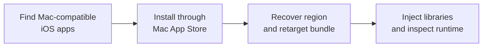

# Darkmach

Darkmach is an iOS reverse-engineering and runtime instrumentation pipeline for Apple Silicon. It connects Mac-compatible app discovery, FairPlay decryption of marked executable regions, Simulator reconstruction and launch-time native instrumentation.

The Mac App Store/Simulator workflow runs with System Integrity Protection (SIP) enabled and does not require a jailbroken device.

The runtime bridge exposes Objective-C objects and methods, process memory, method hooks and traces, runtime class/method injection, WebViews and UI state. Native interceptors capture selected network, keychain, crypto, storage, trust and SQLite operations. The CLI connects target discovery, binary preparation and live inspection in one tool.

Static analysis searches bundled code and resources for URLs, SDK fingerprints and candidate secrets. Runtime inspection reaches state that may exist only in memory: object values, decrypted data, tokens and keys exposed through memory reads or selected hooked calls. These operations support application analysis, behavior tracing, secret extraction and vulnerability investigation.

## Pipeline



1. **Discover:** query App Store availability by keyword, category or app ID; identify iOS binaries available on Mac.
2. **Acquire:** install the selected app through the Mac App Store. Darkmach does not download it.
3. **Inspect and reconstruct:** copy the bundle, inspect its metadata, recover the main executable's marked crypt region when required, adapt platform/bundle metadata, preserve compatible entitlements and re-sign.
4. **Instrument:** install the reconstructed copy on an explicit Simulator and launch it with the native bridge and interceptors.
5. **Investigate:** inspect live state, trace or modify selected runtime behavior, query captured operations and retain the output.

FairPlay decryption here means recovering executable bytes exposed through the system's loading/decryption path. A temporary image restores the original encryption geometry and reads the mapped region from its own process. The final image receives those bytes and clears the encryption description before launch. [How it works](docs/how-it-works.md) traces the sequence; [platform architecture](docs/platform-architecture.md) explains the loading, memory and signing boundaries.

## Runtime surface

| Surface | Operations |
|---|---|
| Objective-C | Class/method/property/ivar enumeration, object lookup, typed zero-argument invocation |
| Hooks and mutation | Method hooking/tracing, class and method injection, delegate replacement |
| Memory | Address reads, pattern scans, heap inspection, snapshots and diffs |
| Network and trust | Selected request/response capture, auth-flow observations, trust and pin inspection; explicit SSL-bypass option |
| Secrets and storage | Keychain operations, crypto calls, user defaults, cookies, filesystem and SQLite activity |
| UI and WebViews | View hierarchy, target/action dispatch, text/scroll operations, JavaScript evaluation and bridge inspection |
| Static analysis | Mach-O/plist inspection, URL and candidate-secret extraction, SDK fingerprints, experimental Hermes analysis |

The [bridge reference](docs/bridge.md) documents commands and wire formats. The [interceptor reference](docs/interceptors.md) names the hooked APIs and native components. Scope and failure semantics matter: [limitations](docs/limitations.md).

## Setup

Requires an Apple Silicon Mac, Python 3.11+, full Xcode and an installed iOS Simulator runtime. From the repository root:

```sh
python3 -m venv .venv
.venv/bin/python -m pip install -e .
mkdir -p src/dylibs/build
make
.venv/bin/darkmach --help
.venv/bin/darkmach bridge --commands
```

`make` builds twelve dylibs and a host utility. The default app launch injects eight components; extraction and optional compatibility/instrumentation modules have separate roles. Python packaging does not compile native assets. See [installation](docs/installation.md) for build, signing and environment checks.

## Target discovery

```sh
.venv/bin/darkmach discover "utilities" --limit 10
.venv/bin/darkmach list
```

`discover` queries remote availability; `list` enumerates iOS wrappers already installed in `/Applications`. Install a selected target through the Mac App Store before running the pipeline. Discovery options and availability codes are in the [CLI reference](docs/cli-reference.md#darkmach-discover).

## Launch and connect

Set `DARKMACH_UDID` to the selected Simulator UUID. Replace `/Applications/Example.app` with your installed bundle:

```sh
DARKMACH_OUTPUT="$PWD/output/target-run" .venv/bin/darkmach run /Applications/Example.app --udid "$DARKMACH_UDID"
.venv/bin/darkmach bridge --udid "$DARKMACH_UDID"
```

`run` copies the original before modification. It analyzes, patches, installs and launches the working copy, then verifies the expected bundle/PID at the selected bridge endpoint. The summary prints the PID, UUID, socket, output paths and run receipt. Use a distinct absolute `--socket` for another target on the same device.

Inside the bridge:

```text
info
view_hierarchy
enumerate_classes Auth
entitlement_scan
raw {"cmd":"info"}
help
quit
```

The [runtime workflow](docs/walkthrough.md) covers device selection, output inspection and capture checks. Standalone `analyze`, `patch` and `launch` commands are documented in the [CLI reference](docs/cli-reference.md).

## Output

`DARKMACH_OUTPUT` overrides the default `./output` root.

| Path | Contents |
|---|---|
| `<output>/<app>/bundle/` | Reconstructed bundle |
| `<output>/<app>/static/` | Static reports; a full run analyzes before reconstruction |
| `<output>/<app>/dynamic/` | Per-module JSONL logs; appends across launches |
| Printed `<output>/<label>/runs/<run-id>.json` | Stage outcomes, source/artifact hashes, strategy, cache/entitlement results, device/socket/PID |
| `<output>/.cache/crypt/<input-sha256>/` | Recovered bytes and geometry/hash receipt |

A verified cache hit reuses an earlier dump. Use a new output root when checking fresh extraction. Logs can span multiple launches; attribute observations by process and time window.

## Constraints

The supported acquisition path is a Mac App Store iOS installation on Apple Silicon. The extract branch recovers the main executable's marked region; it is not a recursive decrypter for arbitrary IPAs. Simulator service availability and binary layout affect compatibility.

Objective-C inspection does not expose every Swift or IL2CPP code path. Capture hooks cover selected API variants. General heap traversal has no native deadline. UI action dispatch does not establish touch/focus, and entitlement readback does not establish every capability-dependent operation. [Limitations](docs/limitations.md) details these boundaries.

## Documentation

- [Installation](docs/installation.md) and [runtime workflow](docs/walkthrough.md).
- [Platform architecture](docs/platform-architecture.md), [recovery sequence](docs/how-it-works.md) and [tool architecture](docs/architecture.md).
- [CLI](docs/cli-reference.md), [runtime bridge](docs/bridge.md), [interceptors](docs/interceptors.md) and [patching](docs/patching.md).

Python modules map directly to `src/`; native code lives under `src/dylibs/`. [Development checks](docs/installation.md#development-checks) lists the existing lint/test commands.

## Disclaimer

Darkmach is provided for research purposes only. Use it only where you have authorization, and comply with applicable laws and agreements. You are responsible for your actions. ul0gic accepts no responsibility for misuse, damage, data loss or other consequences arising from use of this tool. Do not use it to access data without authorization, harm others or disrupt services.

## Support

This project is provided as-is, without a support commitment. Private support and individual walkthroughs are not provided. Consult the documentation before using the tool.
