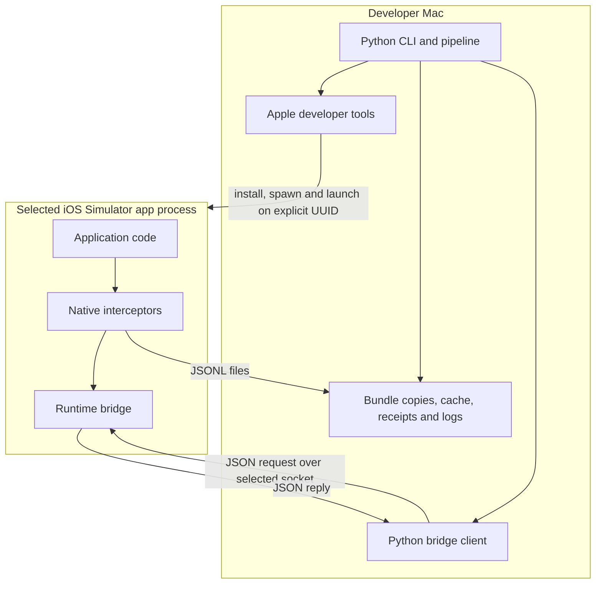
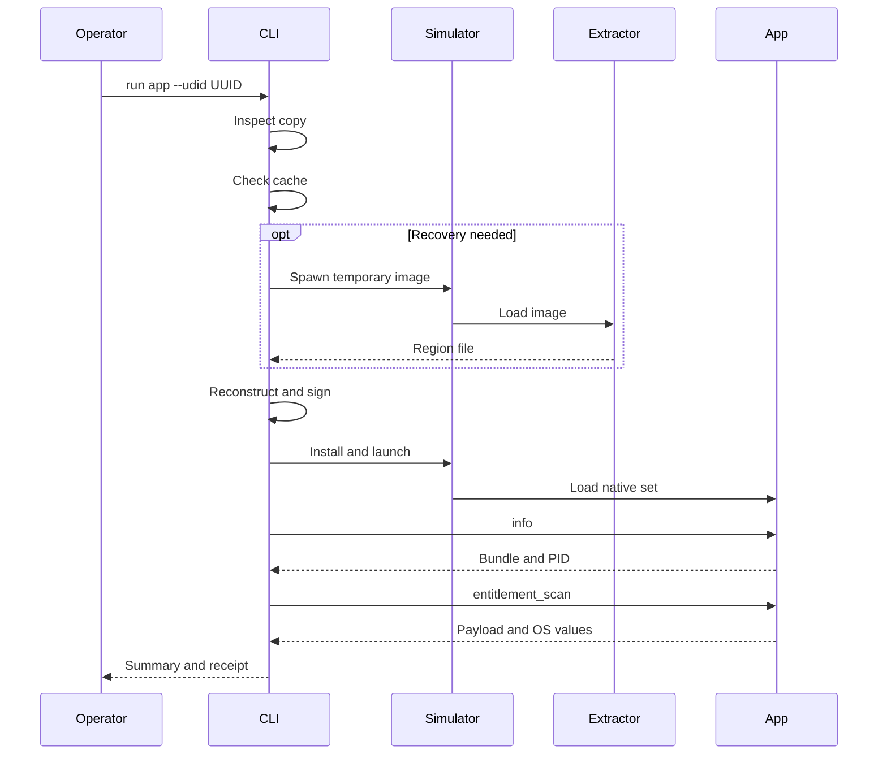

# Darkmach architecture

Darkmach has a host-side preparation pipeline and an in-process observation layer. The host transforms a separate app copy and manages an explicit Simulator session. Native components run inside that app; the bridge exposes queries and selected operations while interceptors write observations.

For Apple's platform model, read [platform architecture](platform-architecture.md). For the byte-recovery sequence, read [two-pass extraction](how-it-works.md).

## Processes and boundaries



The Simulator process is the execution environment, not a physical-device substitute. Kernel loading and dyld library initialization sit below the in-app layer; Darkmach does not implement the cryptographic decryption service. The exact installed-build decryption path remains an interpretation boundary in the [research account](how-it-works.md#why-system-managed-decryption-is-the-working-explanation).

## One full run

`src/cli.py` dispatches to `cmd_run()` in `src/commands.py`. Seven operator-visible steps contain eight receipt stages because installation and launch are recorded separately.

| Step | Owning code | Result |
|---|---|---|
| Locate | `pipeline/bundles.py` and command composition | Resolve outer `Wrapper/*.app` or direct inner bundle; read executable/bundle identity and input main hash |
| Copy | `cmd_run()` | Replace the app's existing working copy under the chosen output root; preserve installed original |
| Analyze | `analysis/bundle.py` | Static reports from the pre-reconstruction copy |
| Select device | `pipeline/simulator.py` | Validate explicit available iOS UUID or unambiguous automatic selection; boot if needed |
| Patch/reconstruct | `pipeline/patching.py`, `patch/surgical.py`, `pipeline/signing.py` | Strategy result, recovered bytes where needed, compatible entitlements and signatures |
| Install/launch | `cmd_run()` and `stage_launch()` | Reinstall the selected bundle on the chosen device and launch with native components |
| Check bridge | `stage_bridge_wait()` and entitlement readback | Expected bundle/PID at the selected endpoint, encoded/OS-readback outcome and terminal receipt |



A warm cache skips the temporary extraction process; an unencrypted input needs no recovery. `patch` performs preparation without installing/launching the final app, while `launch` operates on an already installed bundle and cannot establish fresh extraction. See [CLI reference](cli-reference.md).

## Transformation and strategy selection

The supported acquisition path starts with an iOS app installed through the Mac App Store on the research Mac. `stage_patch()` first chooses a strategy. Encrypted binaries enumerated below the main `Frameworks/` directory select the retained `strategy_a` path; other layouts select `extract`. That decision is a layout heuristic, not proof of an acquisition channel or successful decryption.

The extract path records main-executable geometry and original signed entitlements before mutations. Recovery precedes final transformation. `patch_bundle()` changes Mach-O/platform and plist metadata and signs nested contents inside-out. The verified recovered bytes are then written at the original offset, compatible app entitlements installed and changed binary/bundle signatures renewed.

Strategy A uses replacement entry behavior, Objective-C metadata changes and a survival component for compatibility experiments. A bridge reached through replacement code is not evidence that original encrypted application logic executed. Details and standalone tools are in [patching](patching.md#strategy-decision-tree).

## Capture and bridge

The default launch set in `src/_paths.py` contains eight dylibs: metal-fix, net, keychain, crypto, storage, ssl, db and bridge. The build also produces decrypt, TLS, survival and stealth components. Decrypt belongs to the temporary recovery process; a Strategy A marker adds survival to the final launch. Normal launch does not inject every built artifact.

The launcher supplies `SIMCTL_CHILD_DYLD_INSERT_LIBRARIES`; the child receives `DYLD_INSERT_LIBRARIES`. Native constructors initialize selected method swizzles, C-function interposition and bridge registration. This implementation uses launch-time insertion rather than requiring an external attach client. Loaded libraries and changed method implementations remain observable.

Interceptors own their hooks. Selected callbacks write continuous per-module JSONL and call exported bridge recorders when available. Bridge rings are bounded snapshots; log files append. Recorder readiness is separate from whether an exercised operation produced an observation. Neither representation establishes full API coverage by itself.

The bridge accepts newline-delimited JSON requests over a Unix socket. The dispatcher canonicalizes top-level failures and replaces invalid/over-one-MiB native replies with a small valid error. The Python client applies a total connect/send/receive deadline. Generic typed invocation runs on the bridge worker; UI-specific handlers dispatch to the main queue. An expired client/UI wait does not prove cancellation of already running native work. [Bridge reference](bridge.md#technical-notes) records those contracts and the unbounded `heap_dump` limitation.

## Session identity

`run`, `patch`, `launch`, `status` and `bridge` accept `--udid`. Automatic runtime selection requires the only booted iOS device, or exactly one available iPhone when none is booted and booting is needed. Multiple candidates require explicit selection.

`run`, `launch` and `bridge` accept an absolute `--socket`; otherwise runtime endpoints derive from the UUID as `/tmp/darkmach-bridge-<UUID>.sock`. With no selected/booted device, the standalone client can use legacy `/tmp/darkmach-bridge.sock`. Live endpoints are refused during launch preparation. Stale cleanup checks socket type, ownership and unchanged inode. Bridge readiness checks the requested bundle/PID, not only connectivity.

A distinct socket prevents endpoint collisions, but it does not make concurrent writes to the same app/output directory independent. Use one operator per target/output root.

## Evidence and storage

```text
output/
├── .cache/crypt/<input-main-sha256>/
│   ├── <cryptoff-hex>-<cryptsize-hex>.bin
│   └── <cryptoff-hex>-<cryptsize-hex>.json
└── <app-slug>/
    ├── bundle/       reconstructed working copy
    ├── static/       analysis reports
    ├── dynamic/      append-only interceptor JSONL
    └── runs/         per-invocation stage receipts
```

`src/_paths.py` resolves packaged native/patch assets relative to the installed Python package. Output defaults to the working directory's `output/`; `DARKMACH_OUTPUT` overrides it. `DARKMACH_OUTPUT_DIR` is a different, child-process setting: the launcher sets it to the app's dynamic-log directory.

The crypt-cache sidecar binds input SHA-256, original geometry, recovered length and dump SHA-256. Cache lookup validates identity and data; `_write_crypt_bytes()` verifies the actual consumed bytes and destination bounds. Legacy bundle-ID-only cache entries are not trusted. A verified hit is explicitly reuse, not a new recovery.

Command composition publishes run/patch/launch receipts atomically as stages start/complete. Terminal failure and keyboard interruption retain the completed observations and mark the active stage failed. Receipts carry target/session/hash/patch metadata, not traffic bodies, whole environments or entitlement values. UI and capture validation remain `not-checked` unless separately established outside the command's readiness check.

There are deliberate naming differences: a receipt starts under the input basename, or bundle-ID suffix for standalone `launch`; copied bundle and dynamic sinks use the resolved executable/app name. Retain the printed receipt and log paths rather than deriving one from another. The [walkthrough](walkthrough.md#read-the-artifacts) explains interpretation.

## Source map

| Path | Responsibility |
|---|---|
| `src/cli.py`, `src/commands.py` | Public parser, dispatch and operation composition |
| `src/pipeline/` | Bundle discovery, process execution, patching, signing, Simulator operations and provenance records |
| `src/patch/` | Mach-O transformations and importable tools; stable standalone script names remain available |
| `src/analysis/`, `src/discover.py` | Static bundle/Hermes/keychain inspection and App Store availability discovery |
| `src/bridge/` | JSON transport, rendering, REPL and type encodings |
| `src/dylibs/bridge/` | Native dispatcher, command modules, rings and trace trampoline |
| `src/dylibs/interceptors/` | Network, keychain, crypto, storage, trust, database and TLS components |
| `src/dylibs/compat/`, `src/dylibs/stealth/` | Extraction, compatibility and optional stealth components |
| `src/dylibs/tools/` | Host-side utility sources |
| `tests/` | Existing regression suite |

Setuptools maps the `darkmach` import namespace directly to `src/`; its subpackages use namespace packaging. There is no additional `src/darkmach/` layer. `Makefile` builds Simulator-targeted native assets against the selected SDK; packaging includes assets already built and does not compile them automatically.
