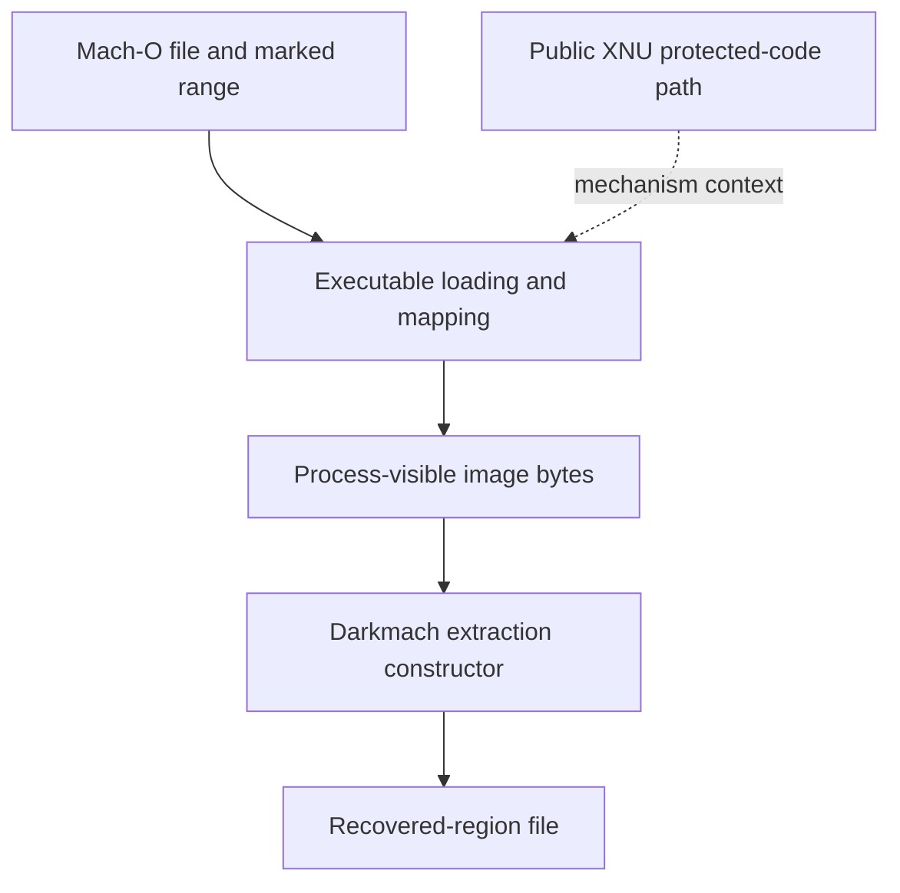

# The platform model behind Darkmach

Darkmach crosses several distinct boundaries: an iOS app delivered to a Mac, the bytes described by its Mach-O file, a process's mapped image, and a reconstructed Simulator app. Understanding those boundaries explains both the two-pass technique and why a successful step does not establish the next one.

This chapter describes the mechanisms relevant to the tool. The [implementation account](how-it-works.md) traces the sequence; [limitations](limitations.md) explains the boundaries of the workflow.

## Delivery is the starting condition

Apple supports distributing eligible iPhone/iPad apps to Apple Silicon Macs through the Mac App Store. The developer controls availability; Apple describes these apps as using the iOS/iPadOS runtime environment on the Mac. That is the supported input channel Darkmach starts from. It is different from compiling an application for the Simulator. [Apple's distribution documentation](https://developer.apple.com/help/app-store-connect/manage-your-apps-availability/manage-availability-of-iphone-and-ipad-apps-on-macs-with-apple-silicon)

| Context | What matters to this workflow |
|---|---|
| Installed Mac-delivered iOS app | Supplies the original bundle, metadata, signature/entitlement inventory and marked main region |
| Temporary Simulator-targeted process | Supplies the process-visible range that the extraction dylib reads |
| Final reconstructed Simulator app | Supplies normal app startup plus injected runtime observation |
| Physical iOS device | A different service, hardware and policy environment; not the measured execution target |

Sharing an ARM64 instruction set does not make these contexts interchangeable. Target metadata, dependencies, services and runtime policy still affect whether an image loads and behaves usefully.

## Mach-O describes more than instructions

Two load commands serve different purposes:

| Metadata | Relevant fields | Role |
|---|---|---|
| `LC_BUILD_VERSION` | `platform`, minimum OS and SDK | Describe the image's platform target; the public header distinguishes iOS (`2`) and iOS Simulator (`7`) |
| `LC_ENCRYPTION_INFO_64` | `cryptoff`, `cryptsize`, `cryptid` | Describe a file range and encryption identifier |

These are file-format definitions in Apple's [Mach-O header](https://github.com/apple-oss-distributions/xnu/blob/e6231be02a03711ca404e5121a151b24afbff733/EXTERNAL_HEADERS/mach-o/loader.h#L1227). They do not by themselves establish what bytes a process observes. Darkmach's transformations change the platform/encryption descriptions; the extraction and reconstruction steps supply a separate byte change.

That distinction is the essential experiment: clearing an encryption marker leaves the original bytes at the file offset unchanged. To demonstrate recovery, compare the original range, new dump and final range independently.

## Encrypted file bytes and mapped bytes are different observations

A file on disk and an executable mapping are different objects. Public XNU source handles encryption load commands through `set_code_unprotect()` and a `text_crypter_create` callback. That is relevant context for protected executable mappings, not a complete description of Apple's private FairPlay implementation. [XNU loader source, pinned revision](https://github.com/apple-oss-distributions/xnu/blob/f6217f891ac0bb64f3d375211650a4c1ff8ca1ea/bsd/kern/mach_loader.c#L1629)

The diagram separates responsibilities; it is not a traced call graph for the installed OS:

Darkmach's extraction constructor finds the main `MH_EXECUTE` image, computes its header address plus `cryptoff`, writes `cryptsize` bytes and exits. It reads its own process memory; it does not implement FairPlay cryptography or obtain a key through a Darkmach API. See [`darkmach-decrypt.c`](../src/dylibs/compat/darkmach-decrypt.c).

The extraction constructor reads process-visible bytes. System-managed decryption is the mechanism context for that operation; this code does not identify the private service or key-handling path of a particular installed OS.

### File offsets are not general memory addresses

The extractor uses `mapped_header + cryptoff`. That matched the tested small regions in the initial text mapping. A general translation must identify the enclosing segment and account for its file offset, virtual address and slide; arbitrary layouts and FAT inputs are not validated by these examples. This assumption is visible in the short extraction source, rather than hidden behind a claim of complete Mach-O layout support.

## Why Darkmach needs two images

The extraction process and the runnable app need different states. The host records the original geometry before mutation and builds them separately.

| Image | Platform description | Encryption description | Bytes in original crypt range |
|---|---|---|---|
| Original installed input | Original iOS metadata | Original range/identifier | Original on-disk bytes |
| Temporary extraction copy | Simulator-targeted metadata | Original geometry restored with `cryptid=1` | Original range retained for loading; process-visible range is read |
| Final reconstructed copy | Simulator-targeted metadata | Cleared encryption command fields | Verified dump written at original file offset |

The temporary copy lets the tool observe a mapped range before normal application startup. The final copy combines suitable metadata with recovered bytes. Neither an extraction constructor exiting successfully nor a final process accepting bridge commands proves that every original application path is usable.

The [two-pass chapter](how-it-works.md#extraction-and-reconstruction) follows the relevant Python and native functions in order.

## dyld insertion provides the observation layer

After reconstruction, Darkmach launches the app with its native libraries in the child insertion list. The Simulator launch tooling passes `SIMCTL_CHILD_DYLD_INSERT_LIBRARIES` as `DYLD_INSERT_LIBRARIES` inside the child. The native components then install their selected hooks and bridge.

Apple's public dyld source derives separate permissions for insertion, path overrides and interposition from process policy. The existence of an environment variable does not establish that every process accepts it. [dyld process configuration, pinned revision](https://github.com/apple-oss-distributions/dyld/blob/e9da5ae571b4191dcdbcfd827363f19847c84561/dyld/DyldProcessConfig.cpp#L893)

The two native roles should not be conflated:

- **Extraction dylib:** reads the mapped main-image range in a short-lived temporary process.
- **Interceptors and bridge:** observe or operate on the reconstructed app during its runtime.

Network/TLS or crypto API capture belongs to that second role. A captured hash/TLS event is not evidence of how FairPlay executable bytes became readable. [Darkmach architecture](architecture.md#capture-and-bridge) maps the actual components.

## Signing and entitlements are separate from recovery

Changing a binary changes what its signature covers, so the pipeline re-signs modified contents. Apple's [code-signing overview](https://support.apple.com/guide/security/app-code-signing-process-sec7c917bf14/web) explains the role of platform signature validation; its device-oriented policy description is not a specification for every Simulator case.

Darkmach reads original signed entitlements before re-signing, keeps its explicit Simulator-compatible allowlist and encodes that dictionary in `__TEXT,__entitlements`. XML is used when it fits; binary plist is tried otherwise. An intact set that still cannot fit is a patching error unless omission was explicitly requested. The tool does not expand the allowlist or manufacture additional rights. See [`signing.py`](../src/pipeline/signing.py).

Three observations remain distinct:

| Observation | What it establishes |
|---|---|
| Encoded dictionary equals the original compatible dictionary | The selected payload values were preserved |
| Process SecTask readback reports matching selected values | The OS query returned those values for that process |
| A real capability-dependent operation succeeds | That particular operation works in the tested runtime |

Preserving an encoded dictionary and querying selected OS-reported values do not establish that every app-group, Keychain, association or hardware-backed operation will work. Those operations require their own checks.

## Terms used in the source

| Term | Meaning here |
|---|---|
| Crypt region | File range described by the main executable's encryption command |
| Geometry | The recorded offset and length of that range |
| Platform retargeting | Changing metadata that identifies the intended platform |
| Reconstruction | Writing verified recovered bytes into the transformed final copy |
| Interposition / swizzling | Replacing selected C-function calls / Objective-C implementations for observation or operation |
| Readback | Querying the running process's selected entitlement values, separately from parsing the embedded payload |

Continue with [two-pass extraction](how-it-works.md), [Darkmach architecture](architecture.md), or the [worked investigation](walkthrough.md).
