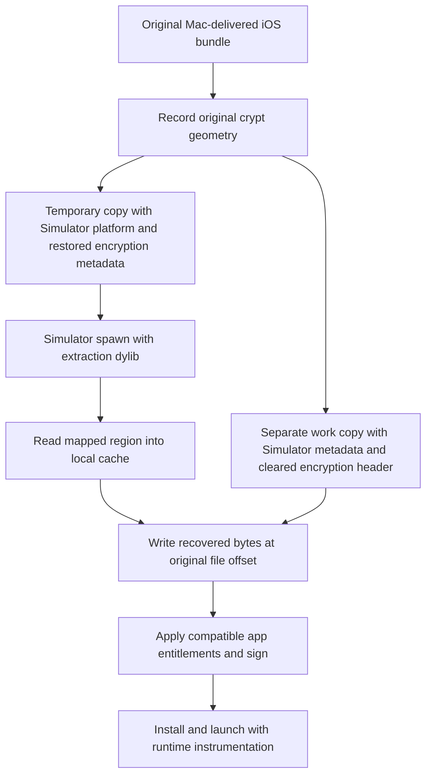

# FairPlay extraction through the iOS Simulator

Darkmach's extract path uses a temporary Simulator-targeted copy of a Mac-delivered iOS application to recover a marked encryption region, then writes those bytes into a separate runnable copy. The important state transition is preserving the encryption description during extraction and clearing it only for the reconstructed image.

Status: publication draft; current-host main-region extraction observed on two targets · Updated: 2026-11-02

## Platform metadata and encrypted code

An arm64 instruction stream is only part of what makes an executable loadable. Mach-O load commands identify the intended platform, dependencies and encryption range. Apple's [Mach-O header definitions](https://github.com/apple-oss-distributions/xnu/blob/main/EXTERNAL_HEADERS/mach-o/loader.h) assign platform values 2 to iOS and 7 to iOS Simulator, and describe the `cryptoff`, `cryptsize` and `cryptid` fields.

Changing the platform value changes the loader's description of the image. It does not rebuild dependencies, provide missing device services, or decrypt code. Likewise, clearing an encryption load command leaves the bytes at that file offset unchanged. A successful reconstruction needs both suitable metadata and usable bytes.

The supported acquisition workflow begins with an iOS app installed through the Mac App Store on the research Mac. Apple documents this distribution channel in [Running your iOS apps in macOS](https://developer.apple.com/documentation/apple-silicon/running-your-ios-apps-in-macos). App availability and host delivery are prerequisites; Darkmach does not supply a general acquisition route for arbitrary iOS-only IPAs.

## Binary state transitions

The table describes the main executable on the extract path. The original crypt geometry is captured before patching.

| Image | Platform metadata | Encryption metadata | Bytes in the original crypt range |
|---|---|---|---|
| Original installed bundle | iOS | Original nonzero range and `cryptid` | Original on-disk bytes |
| Temporary extraction copy | iOS Simulator | Original range restored with `cryptid=1` | Original range retained for the system's loader/decryption path |
| Final reconstructed copy | iOS Simulator | `cryptoff`, `cryptsize` and `cryptid` cleared | Bytes recovered from the temporary process |

## Extraction and reconstruction

[`stage_patch()`](../../src/pipeline/patching.py) selects the strategy, reads the original main executable's crypt geometry and signed entitlements, and invokes `_extract_crypt_region()` before patching the final work copy.

On a cache miss, extraction proceeds as follows:

1. Copy the input bundle into a unique temporary workspace under `/tmp/darkmach-decrypt-*/`.
2. Run `patch_bundle()` on that temporary copy to adapt platform metadata, bundle plists and signatures.
3. Restore the original `cryptoff` and `cryptsize`, and set `cryptid=1` in the temporary main executable.
4. Re-sign that executable and spawn it through `simctl spawn` with `darkmach-decrypt.dylib` inserted.
5. Read the marked range from the mapped executable, write it to a unique private output file, and exit the temporary process.
6. Require exactly `cryptsize` bytes, hash the dump, and publish it with its source/geometry-bound cache receipt before continuing.

The separate work copy then passes through `patch_bundle()`. `_write_crypt_bytes()` verifies the consumed dump's hash and destination bounds before writing at the original file offset. The pipeline preserves the original allowlisted Simulator-compatible entitlement dictionary in a `__TEXT,__entitlements` section, using XML or binary plist, and re-signs the modified binary and bundle. An intact set that cannot fit is an error unless omission was explicitly requested with `--strip-entitlements`. Encoded values and OS entitlement readback are distinct observations; neither proves every original capability.

This sequence has no entry-point shellcode on the extract path. The shellcode and survival machinery belong to the separate experimental Strategy A branch.

## What the extractor actually reads

[`darkmach-decrypt.c`](../../src/dylibs/compat/darkmach-decrypt.c) finds the loaded `MH_EXECUTE` image using dyld's image list. Its constructor reads environment-provided geometry, computes `mapped_header + cryptoff`, and writes `cryptsize` bytes using ordinary in-process memory access and file I/O. It does not call `mach_vm_read`, attach to another process, or implement FairPlay cryptography.

The address calculation assumes that the relevant file offsets correspond to offsets from the mapped header. For the recorded small crypt regions in the initial text mapping, this matched the observed layout. A general extractor would translate through the enclosing segment's `fileoff` and `vmaddr`; arbitrary segment layouts and FAT containers require separate validation.

The constructor exits after writing the dump. A dump therefore does not by itself demonstrate that the original application entry point executed successfully.

## Why system-managed decryption is the working explanation

Apple's published [XNU loader source](https://github.com/apple-oss-distributions/xnu/blob/main/bsd/kern/mach_loader.c) includes `set_code_unprotect()`. It distinguishes encryption identifiers, creates a text decrypter, translates the file range into a mapped range, and calls `vm_map_apple_protected()`. That source supports the general distinction between encrypted file bytes and a process's readable mapped view.

Darkmach's historical local record reports readable ARM64 code recovered from a temporary image retaining its encryption metadata, followed by execution of the reconstructed application. This is consistent with system-managed decryption. The extraction dylib simply reads the result.

The exact private service interactions on the tested host remain an inference. The repository does not contain a build-matched trace proving a chain through `mremap_encrypted`, `IOTextEncryptionFamily` and `fairplayd`, nor evidence that changing a platform flag is sufficient for every bundle. The published XNU tree is a reference implementation, not proof of the installed kernel's exact behavior.

## Strategy selection and its limits

`_detect_strategy()` checks the bundle binaries enumerated by `_iter_bundle_binaries()`. If an encrypted binary lies beneath the main bundle's `Frameworks/` directory, it chooses `strategy_a`; otherwise it chooses `extract`.

That is a layout heuristic. It does not authenticate an app's distribution channel or prove whether the host can decrypt it. The extract branch recovers only the main executable's marked region. It is not a recursive decrypter for every encrypted Mach-O in a bundle.

Strategy A replaces entry behavior and neutralizes selected metadata so an otherwise incompatible image may load far enough for instrumentation experiments. A process that reaches a bridge after replacement is not evidence that the original encrypted application logic was recovered. See the [patching guide](../patching.md#strategy-decision-tree) for the retained machinery.

## What counts as confirmation

A fresh extraction result should bind the original bundle hash, original region bytes, temporary header state, new dump and reconstructed binary to one recorded run. Confirm the recovered range with coherent disassembly and code references, then demonstrate execution that depends on that range. A byte count or plausible instruction sequence alone is insufficient: arbitrary data can decode as ARM64 instructions.

Cache reuse needs particular care. Current entries bind the original main-executable SHA-256, region geometry, recovered length and recovered-byte SHA-256 through a versioned receipt. Legacy bundle-ID-only entries are ignored. A verified hit establishes reuse, not a fresh recovery; use a new output root without a matching cache when testing fresh extraction after a platform update.

The [methodology](methodology.md) defines the controls and evidence record. [Validation and findings](findings.md) separates historical results, fresh main-region recovery and current application UI observations.
